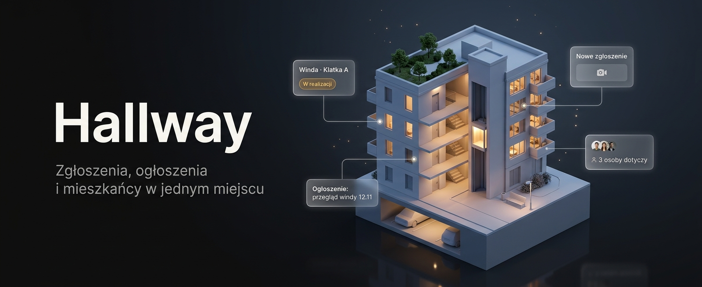

  

  <a href="https://hallway.pl"><b>Aplikacja</b></a>
  &nbsp;·&nbsp;
  <a href="https://dev.hallway.pl"><b>Demo</b></a>
  &nbsp;·&nbsp;
  <a href="https://docs.hallway.pl"><b>Dokumentacja</b></a>

  
  
  
  

  
  
  
  
  
  

 

  

